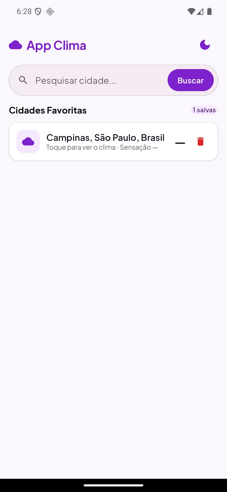
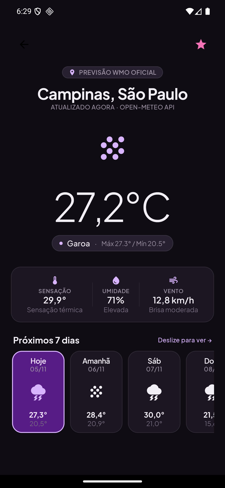

# ☁️ App Clima — Projeto 08 (PDM 4º Bimestre)

Aplicativo Android de consulta meteorológica desenvolvido com **Kotlin + Jetpack Compose**, conforme especificação do [ProjetoPDM-4Bimestre](https://github.com/perabru/ProjetoPDM-4Bimestre).

## 🔗 API

[Open-Meteo](https://open-meteo.com/) — API gratuita, sem chave:
- `v1/search` — geocoding (pesquisa de cidades em português)
- `v1/forecast` — clima atual + previsão de 7 dias

## ✅ Funcionalidades

- Pesquisar cidades por nome (geocoding)
- Consultar API meteorológica pela internet
- Exibir temperatura atual, sensação térmica, umidade e vento
- Apresentar condições meteorológicas traduzidas (códigos WMO)
- Ícones/emojis relacionados ao clima
- Marcar/remover **favoritos** (persistidos com SharedPreferences)
- **Atualização sob demanda** (botão "Tentar de novo" na falha)
- Tratamento de falhas de conexão com mensagem compreensível

## 🏗️ Estrutura (MVVM)

```
app/src/main/java/br/com/perabru/appclima/
├── MainActivity.kt               # ComponentActivity + setContent + Navigation
├── data/
│   ├── remote/
│   │   ├── OpenMeteoApi.kt       # Retrofit: endpoints + DTOs
│   │   └── RetrofitClient.kt     # Instância do Retrofit
│   └── repository/
│       └── ClimaRepository.kt    # Rede + persistência de favoritos
├── domain/model/Modelos.kt       # Cidade, Clima, Dia
├── ui/
│   ├── screens/Telas.kt          # TelaBusca + TelaDetalhe (Compose)
│   └── theme/Theme.kt            # Material Design 3 (claro/escuro)
├── util/CodigosClima.kt          # Códigos WMO -> descrição + emoji
└── viewmodel/ClimaViewModel.kt   # StateFlow + estados (Carregando/Pronto/Erro)
```

## 🧠 Conceitos trabalhados

`@Composable` • `TextField` • `LazyColumn` • `Card` • `ListItem` • `remember/mutableStateOf` •
`suspend` • **Kotlin Coroutines** • **Retrofit** • **Repository** • **ViewModel** • **StateFlow** •
**Navigation Compose** • **Material 3** • tratamento de estados de carregamento

## ▶️ Como executar

1. Abra a pasta no Android Studio e aguarde o Gradle sincronizar
2. Configure um emulador (ou dispositivo físico) com internet
3. Run ▶ (minSdk 24)

## 📸 Capturas de tela

| Busca (claro) | Detalhe (escuro) |
|---|---|
|  |  |

Mais capturas nos 2 temas em `screens/`.

## 📊 Critérios contemplados

| Critério | Como atende |
|---|---|
| Funcionalidades (35%) | Todas as obrigatórias + favoritos (desafio extra) |
| Interface (20%) | Material 3, tema claro/escuro, ícones e estados visuais |
| Organização (20%) | MVVM com separação em data/domain/ui/viewmodel/util |
| Erros e testes (15%) | Estados `Carregando/Erro` com retry e mensagem amigável |
| Documentação (10%) | Este README + comentários no código |
